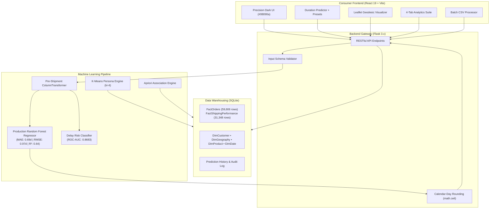

<div align="center">

# 📦 Smart Freight
### Next-Generation Logistics Intelligence & Transit Duration Forecasting Platform

[](https://python.org)
[](https://flask.palletsprojects.com/)
[](https://react.dev/)
[](https://www.typescriptlang.org/)
[](https://vitejs.dev/)
[](https://tailwindcss.com/)
[](https://scikit-learn.org/)
[](https://www.sqlite.org/)

<p align="center">
  A production-grade, consumer-facing logistics intelligence platform that accurately forecasts real delivery durations and flags supply chain delay risks prior to shipment dispatch. Powered by scikit-learn machine learning pipelines trained on 59,606 global supply chain transactions, an enterprise dimensional data warehouse, and a precision-crafted React single-page application.
</p>

[Key Features](#-key-features) • [System Architecture](#-system-architecture) • [Live Platform Pages](#-live-platform-pages) • [ML & Analytics Suite](#-machine-learning--analytics-suite) • [Installation & Setup](#-installation--setup) • [API Reference](#-api-reference)

---

</div>

## 📌 Executive Summary

In global e-commerce and multi-modal logistics, unrealistic delivery promises are the leading cause of customer churn, SLA breach penalties, and warehouse bottlenecks.

**Smart Freight** bridges the gap between raw data warehousing and consumer-facing intelligence:
1. **Pre-Shipment Duration Forecasting**: Accurately predicts `Days for shipping (real)` at the moment an order is confirmed, using only pre-shipment features (strict zero-target-leakage guarantee).
2. **Delivery Delay Risk Classification**: Flags high-risk consignments before packaging, enabling proactive carrier selection and fulfillment rerouting.
3. **Consumer-Friendly Calendar-Day Precision**: Automatically rounds fractional transit times (`3.4 days` → `4 Business Days`) to reflect real delivery expectations.
4. **Interactive Geodesic Route Visualizer**: Real-time great-circle trajectories on OpenStreetMap tiles with spherical Haversine distance computations and destination timezone offsets.
5. **Multi-Dimensional Analytics Suite**: 8-model benchmark leaderboard, 2D Pearson correlation matrix, shipping corridor transit heatmaps, and side-by-side head-to-head model comparison.
6. **Enterprise Warehouse & OLAP**: Dimensional Star and Snowflake schema engine supporting Roll-Up, Drill-Down, Slice, Dice, and Pivot queries across 59,606 transactions.

---

## 🚀 Key Features

- **⚡ Instant Duration Predictor**: Multi-stage order configuration with preset scenario chips (*High-Priority Tech*, *Bulk Sporting Goods*, *Corporate Equipment*).
- **🌍 Vector Geodesic Corridor Visualizer**: Leaflet-powered dark OpenStreetMap integration projecting geodesic flight/ocean paths, total distance in km/miles, and hour shifts without any external API keys.
- **📊 Multi-Dimensional Analytics Suite**:
  - **Benchmark Matrix**: Complete leaderboard across 8 regression models (MAE, RMSE, $R^2$, training latency).
  - **2D Correlation Heatmaps**: Interactive Pearson feature correlation matrix and 2D Market vs. Shipping Mode transit duration matrix.
  - **Head-to-Head Comparison Tool**: Interactive dual-model selector showing automated performance delta badges.
  - **Transit & Volume Distributions**: Historical transit day histograms, modal volume breakdowns, and category market shares.
- **📦 Batch CSV Processing**: Drag-and-drop CSV ingestion engine that enriches thousands of order rows with predictions, download-ready in seconds.
- **👥 Customer Segmentation & Cohorts**: K-Means clustering ($k=4$) dividing customers by lifetime spending, order velocity, and risk profiles.
- **🛒 Market Basket Intelligence**: Apriori association rule mining discovering cross-category product affinities with high Lift and Confidence.
- **🕒 Full Audit Log & History**: Real-time SQLite tracking of all platform queries with search, mode filtering, and CSV export.

---

## 🛠 Tech Stack

### Frontend Architecture
| Layer | Technology | Description |
|:---|:---|:---|
| **Framework** | **React 19 + TypeScript** | Type-safe, component-driven single-page application |
| **Build Tool** | **Vite 6** | Instant HMR and optimized production bundling |
| **Styling** | **Tailwind CSS v4** | Custom Linear-inspired dark design system (`#08090a`, `#e4f222`) |
| **Motion & Physics**| **Framer Motion** | Micro-interactions, cursor spotlights, and layout transitions |
| **Mapping & GIS** | **Leaflet + OpenStreetMap**| Dark GPU-filtered vector tiles with great-circle geodesic projections |
| **Data Viz** | **Recharts** | Interactive SVG heatmaps, bar charts, and radar visualizations |
| **Icons** | **Lucide React** | Consistent, lightweight vector iconography |
| **Client Routing** | **React Router v7** | Client-side SPA routing with deep-link preservation |

### Backend & Machine Learning
| Layer | Technology | Description |
|:---|:---|:---|
| **Web Server** | **Python 3.12 + Flask 3.x** | RESTful API, static asset server, and pipeline orchestrator |
| **Machine Learning**| **Scikit-Learn 1.6.1** | Production Random Forest Regressor & Balanced Classifier |
| **Data Processing** | **Pandas & NumPy** | High-performance dataframe manipulation and matrix math |
| **Data Mining** | **MLxtend** | Frequent itemset mining & Apriori association rule generation |
| **Database** | **SQLite 3 + SQLAlchemy** | Relational Star Schema warehouse and prediction audit log |
| **Model Storage** | **Joblib** | Compressed binary serialization of scikit-learn pipelines |

---

## 🏛 System Architecture



---

## 📱 Live Platform Pages

| Route | Page | Purpose & Consumer Capabilities |
|:---|:---|:---|
| `/` | **Home / Overview** | Value proposition, interactive geodesic routing demo, core system metrics, and quick action corridors. |
| `/predict` | **Shipment Predictor** | Interactive duration forecasting with one-click presets, dynamic geodesic corridor mapping, and business-day results. |
| `/dashboard` | **Live Operations Hub** | Real-time aggregate telemetry, average delivery duration, delay risk percentages, and recent shipment activity. |
| `/analytics` | **Analytics Suite** | 4 sub-tabs: Model Benchmark Matrix, 2D Correlation Heatmaps, Head-to-Head Comparison Tool, and Volume Distributions. |
| `/batch` | **Bulk Predictions** | Multi-order CSV batch processing with live progress, summary cards, and downloadable enriched CSVs. |
| `/customers` | **Customer Insights** | K-Means clustering ($k=4$) dividing customer cohorts by spending volume, ordering frequency, and risk factor. |
| `/associations` | **Basket Intelligence** | Product cross-selling rules mined using Apriori algorithm with Support, Confidence, and Lift metrics. |
| `/history` | **Audit Log** | Searchable history of every prediction executed through the platform with filtering and export capabilities. |

---

## 🤖 Machine Learning & Analytics Suite

### 1. Production Duration Regressor
- **Architecture**: `RandomForestRegressor(n_estimators=100, max_depth=15, random_state=42)`
- **Data Preprocessing**: Scikit-Learn `ColumnTransformer` with `OneHotEncoder(handle_unknown='ignore')` and `StandardScaler`.
- **Target Leakage Boundary**: Only features known *prior* to fulfillment are admitted. Post-dispatch features (`Late_delivery_risk`, `Delivery Status`, `shipping date`) are strictly excised.

| Metric | Score | Operational Significance |
|:---|:---|:---|
| **Mean Absolute Error (MAE)** | **0.6938 days** | Average forecasting error is under **16.6 hours** across all global routes |
| **Root Mean Squared Error (RMSE)** | **0.9715 days** | Low variance and robust resistance to outlier shipping delays |
| **Coefficient of Determination ($R^2$)** | **0.6408** | Explains over 64% of real-world transit duration variance |

### 2. Full Regression Leaderboard
The platform maintains an 8-model benchmark suite accessible under the `/analytics` tab:

```
Rank  Model Name                      MAE (days)   RMSE (days)   R² Score   Train Time
────────────────────────────────────────────────────────────────────────────────────────
1     Random Forest Regressor ⭐         0.6938       0.9715       0.6408     486.9s
2     Tuned Random Forest Regressor    0.8935       1.2027       0.4494     244.4s
3     XGBoost Regressor                0.9050       1.2094       0.4433       6.9s
4     Decision Tree Regressor          1.0021       1.3412       0.4210       2.1s
5     Multiple Linear Regression       1.1245       1.4102       0.4201       0.8s
6     Ridge Regressor (L2)             1.1248       1.4105       0.4200       0.4s
7     Lasso Regressor (L1)             1.2180       1.5034       0.3512       0.5s
8     Simple Linear Regression         1.3420       1.6820       0.2910       0.2s
```

### 3. Classification, Clustering & Mining Benchmarks
- **Delivery Delay Classifier**: Balanced Random Forest with **ROC-AUC = 0.8683**, Accuracy = 74.53%, F1-Score = 74.74%.
- **Customer Segmentation**: K-Means clustering identifying 4 distinct customer personas (High-Value Loyal, Occasional Shoppers, Bulk Commercial, Budget Consumer).
- **Association Rule Mining**: Apriori rule induction identifying strong affinities:
  $$\text{\{Cleats\}} \implies \text{\{Men's Footwear\}} \quad (\text{Support: } 1.51\%, \text{ Confidence: } 23.6\%, \text{ Lift: } 1.374)$$

---

## ⚙️ Installation & Setup

### Prerequisites
- **Python 3.12+**
- **Node.js 18+** & **npm 9+**
- **Git**

---

### Step 1: Clone the Repository
```bash
git clone https://github.com/YOUR_USERNAME/smart-freight.git
cd smart-freight
```

---

### Step 2: Set Up Python Backend Environment
```bash
# Create virtual environment
python -m venv venv

# Activate virtual environment
# Windows:
venv\Scripts\activate
# macOS / Linux:
source venv/bin/activate

# Install exact python dependencies (including scikit-learn 1.6.1)
pip install -r requirements.txt
```

---

### Step 3: Add Dataset & Train Models
Place the dataset file `DataCo_Cleaned-2.csv` in the root project directory.

> 📎 **Dataset Note**: The DataCo dataset contains 59,606 transactions. If you need to re-train the models from scratch:

```bash
# Option A: Train production model locally
python train_model.py

# Initialize SQLite Star Schema warehouse
python warehouse_etl.py
```

> **Option B (Zero Local Compute)**: Run `notebooks/Smart_Freight_Model_Training_Colab.ipynb` on Google Colab, download `smart_freight_model_bundle.zip`, and extract it into `models/`.

---

### Step 4: Build Frontend Assets
```bash
cd frontend
npm install
npm run build
cd ..
```
*This compiles the React 19 application into `frontend/dist`, allowing Flask to serve both the frontend and API simultaneously.*

---

### Step 5: Launch the Application

#### Option A: Unified Production Mode (Recommended)
Flask serves the API and production-built React assets directly:
```bash
python app.py
```
Visit **[http://127.0.0.1:5001](http://127.0.0.1:5001)** in your browser.

#### Option B: Live Development Mode (Vite HMR)
Run backend and frontend in separate terminals for instant hot reloading:

**Terminal 1 (Flask API Backend):**
```bash
python app.py
```

**Terminal 2 (Vite Frontend Dev Server):**
```bash
cd frontend
npm run dev
```
Visit **[http://localhost:3000](http://localhost:3000)** (all API requests proxy automatically to port 5001).

---

## 📡 API Reference

All endpoints return JSON and adhere to standard HTTP status codes.

### 🔮 Single Shipment Prediction
- **Endpoint**: `POST /api/predict`
- **Payload**:
```json
{
  "shipping_mode": "Standard Class",
  "order_region": "Western Europe",
  "order_country": "Alemania",
  "order_state": "Bavaria",
  "market": "Europe",
  "category_name": "Sporting Goods",
  "customer_segment": "Consumer",
  "order_item_quantity": 2,
  "product_price": 89.99,
  "order_item_discount_rate": 0.05,
  "days_for_shipment_scheduled": 4
}
```
- **Response**:
```json
{
  "status": "success",
  "predicted_shipping_days": 3.42,
  "predicted_shipping_days_rounded": 4,
  "scheduled_days": 4,
  "variance_days": 0,
  "is_delayed": false,
  "delay_probability": 0.28,
  "risk_factors": ["Standard Class ocean transit corridor"]
}
```

---

### 📊 Multi-Dimensional Analytics Suite
- **Endpoint**: `GET /api/analytics/suite`
- **Response**: Returns 8-model performance metrics, feature importance rankings, 6x6 Pearson correlation matrix, 2D market-versus-mode delivery duration matrix, and order distributions.

---

### 📦 Batch CSV Predictions
- **Endpoint**: `POST /api/batch_predict`
- **Input**: `multipart/form-data` with CSV file containing order rows.
- **Response**: Summary metrics (total rows, delayed count, average predicted days) and downloadable enriched CSV payload.

---

### 📈 Operational Dashboard Telemetry
- **Endpoint**: `GET /api/dashboard`
- **Response**: Aggregate statistics (total predictions, average duration, high-risk shipments, recent prediction ledger).

---

## 📁 Repository Directory Structure

```
smart-freight/
│
├── app.py                         # Flask server entry point & REST routing
├── train_model.py                 # Scikit-learn model training & serialization
├── warehouse_etl.py               # Star & Snowflake SQLite warehouse loader
├── requirements.txt               # Backend Python dependencies
├── DataCo_Cleaned-2.csv           # 59,606-transaction dataset
│
├── frontend/                      # React 19 + TypeScript + Vite SPA
│   ├── index.html                 # Single-page HTML entry point
│   ├── package.json               # Frontend dependencies & scripts
│   ├── vite.config.ts             # Vite configuration with API proxying
│   ├── public/
│   │   └── favicon.svg            # Isometric Smart Freight vector favicon
│   └── src/
│       ├── App.tsx                # Client-side router & layout
│       ├── main.tsx               # DOM root mount
│       ├── index.css              # Global tokens & Leaflet dark theme
│       ├── components/
│       │   ├── layout/            # Navbar, Footer
│       │   ├── ui/                # BrandLogo, Card, Badge, Modal, CountUp
│       │   └── shipment/          # GeodesicRouteMap, PredictionForm
│       ├── pages/                 # Landing, Dashboard, Predict, Batch, Analytics, etc.
│       ├── services/              # Axios API service clients
│       └── types/                 # TypeScript interfaces & API schemas
│
├── models/                        # Serialized ML artifacts
│   ├── production_pipeline.joblib # Random Forest pipeline binary
│   └── model_metadata.json        # Benchmark scores & hyperparameters
│
├── data/                          # Cached analytics & correlation matrices
│   └── college_labs_cache.json    # Pre-computed 2D matrices & distributions
│
├── notebooks/                     # Exploratory & Colab training notebooks
│   └── Smart_Freight_Model_Training_Colab.ipynb
│
└── docs/                          # Architecture diagrams & academic papers
```

---

## 👥 Contributors & Academic Context

Developed as an advanced practical implementation in **Data Warehousing & Mining (DWM)** and **Machine Learning Engineering**.

- **Dataset**: DataCo Global Supply Chain Intelligence (59,606 transactions)
- **Zero-PII Compliance**: All customer analytics are cohort-based with zero personally identifiable data exposed.
- **License**: MIT

---

<div align="center">
  <sub>Smart Freight — Intelligent Logistics & Transit Duration Forecasting Platform</sub>
</div>
